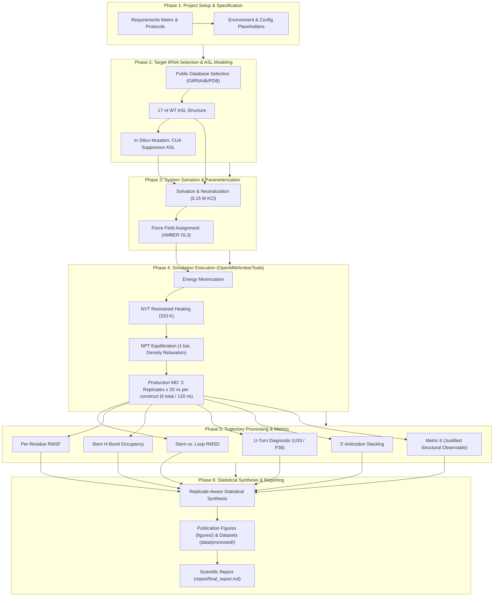

# 03 - System Architecture & Pipeline Workflow

## 1. Architectural Philosophy

This research project is engineered as an automated, reproducible scientific computing pipeline. It adheres to three foundational software engineering principles for scientific research:

1. **Strict Separation of Concerns:**
   - Configuration is externalized in declarative YAML files (`config/`).
   - Domain logic for structural calculations resides in modular, tested Python packages (`analysis/`).
   - Execution workflows are orchestrated via version-controlled driver scripts (`scripts/`).
   - Simulation state and analysis results are strictly organized in dedicated data hierarchies (`data/`, `simulations/`, `figures/`).
2. **Deterministic & Reversible Execution:**
   - Every stage consumes explicitly defined input files and produces structured outputs (CSVs, JSON metadata, publication figures).
   - Randomness (initial velocities) is controlled via explicit seeds recorded in configuration.
3. **Storage Hygiene & Non-Committal of Large Trajectories:**
   - Trajectory data files (`.dcd`, `.xtc`, `.nc`) remain local and uncommitted to version control.
   - Processed time-series summaries, structural metrics, and convergence statistics are lightweight and versioned in `data/processed/`.

---

## 2. End-to-End Pipeline Workflow



---

## 3. Directory Layout & Module Responsibilities

```text
trna-asl-md-stability/
├── config/
│   ├── simulation_config.yaml      # Master parameters for solvation, ions, ensemble, seeds
│   └── analysis_config.yaml        # Metrics thresholds, atom selections, statistical protocols
├── data/
│   ├── raw/                        # Original source PDBs and GtRNAdb sequence fasta
│   ├── processed/                  # Cleaned time-series tables (RMSD, RMSF, H-bonds, angles)
│   └── metadata/                   # Run provenance, hardware logs, execution timestamps
├── structures/                     # Prepared PDB/mmCIF files for WT and CUA suppressor ASLs
├── simulations/                    # Simulation staging directories (topologies, state XMLs)
├── scripts/                        # Sequential driver scripts (01 to 06)
│   ├── 01_prepare_asl_models.py    # Generates WT and CUA 17-nt ASL starting coordinates
│   ├── 02_setup_system.py          # Builds water box, adds KCl, applies OL3 force field
│   ├── 03_equilibrate.py           # Minimization, NVT heating, NPT density relaxation
│   ├── 04_run_production.py        # Runs 20 ns production per replicate with seed control
│   ├── 05_analyze_trajectories.py  # Computes the 6 structural trajectory metrics
│   └── 06_statistical_synthesis.py # Computes bootstrap CIs, tests, and plots figures
├── analysis/                       # Reusable Python analysis library
│   ├── __init__.py
│   ├── rmsd.py                     # Backbone RMSD (stem vs loop) computation
│   ├── rmsf.py                     # Per-residue RMSF computation
│   ├── hbonds.py                   # Hydrogen-bonding geometric analysis
│   ├── uturn.py                    # U-turn distance and dihedral diagnostics
│   ├── stacking.py                 # Nucleobase centroid distance and planar angles
│   ├── additional_metric.py        # 6th structural metric implementation
│   └── statistics.py               # Autocorrelation time, block averaging, replicate tests
├── figures/                        # High-resolution vector and publication figures
├── notebooks/                      # Exploratory and audit Jupyter notebooks
├── docs/                           # Full scientific documentation and protocol specifications
└── report/                         # Final formal scientific report and manuscript
```

---

## 4. Software Dependencies & Execution Stack

- **Molecular Simulation Engine:** OpenMM (v8.1+) / AmberTools (v23+)
  - GPU-accelerated (CUDA) or robust CPU platform fallback.
  - Native support for AMBER OL3 force fields and PME electrostatics.
- **Trajectory Traversal & Geometric Analysis:** MDAnalysis (v2.7+) and MDTraj (v1.9+)
  - Fast vectorized atom-selection algebra.
  - Robust handling of periodic boundary conditions (PBC unwrapping and centering).
- **Scientific Computing & Statistical Modeling:** NumPy, SciPy, Pandas
  - Automated estimation of statistical inefficiency / autocorrelation times.
  - Non-parametric hypothesis testing and bootstrap resampling.
- **Visualization:** Matplotlib, Seaborn
  - Publication-ready, high-DPI rendering following scientific figure styling guidelines.
