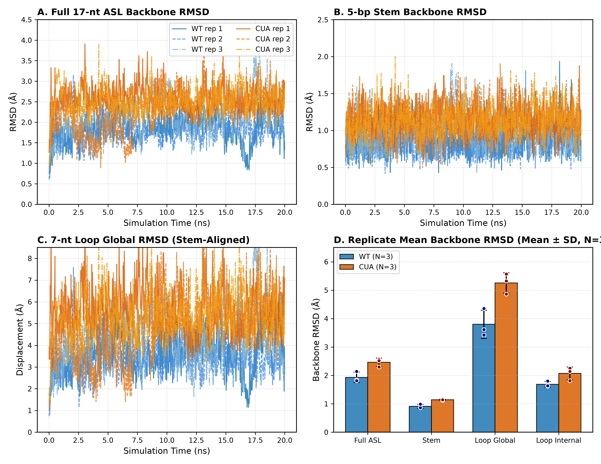
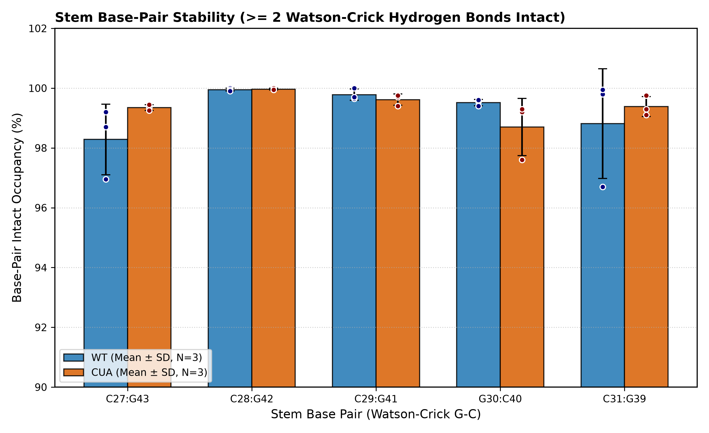
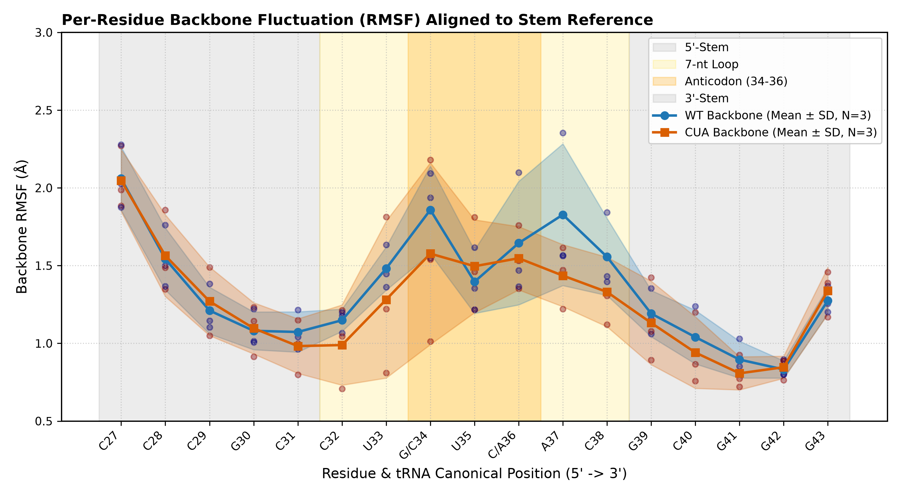
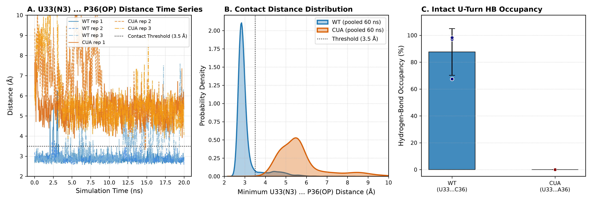
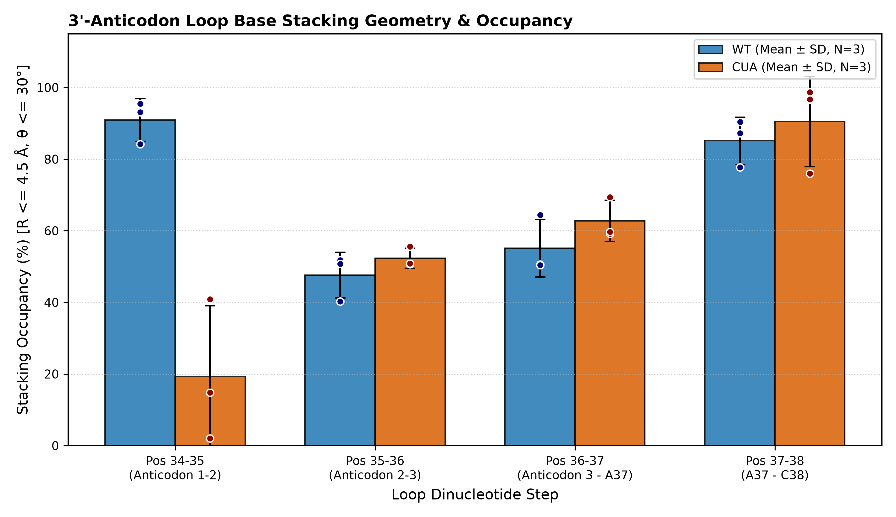
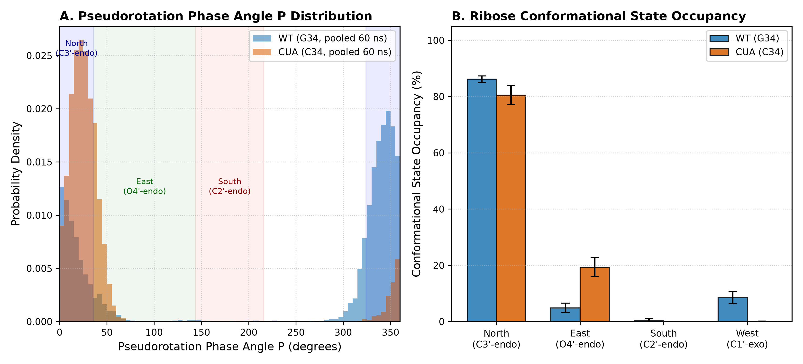

# Structural Stability of a Human tRNA Anticodon Stem-Loop upon Mutation to an Amber Suppressor: A Molecular Dynamics Investigation

**Author:** Nitin Jadhav  
**Repository:** [https://github.com/nitinjadhav888/trna-asl-md-stability](https://github.com/nitinjadhav888/trna-asl-md-stability)  
**Date:** November 2026  

---

## 1. Executive Summary & Direct Scientific Answer

When the anticodon of human cytoplasmic $\text{tRNA}^{\text{Asp}}\text{(GTC-2-1)}$ 17-nucleotide anticodon stem-loop (ASL; wild-type sequence `5'-CCGCCUGUCACGCGG-3'`) is mutated by two nucleotide substitutions to the UAG amber suppressor anticodon CUA (`5'-CCGCCUCUAACGCGG-3'`), the ASL does **not** undergo global unfolding or stem denaturation; rather, the 5-base-pair helical stem remains locked and highly persistent ($\ge 98.5\%$ base-pairing across all runs), while the 7-nucleotide anticodon loop undergoes **substantial local structural reorganization**. Across $120.0\ \text{ns}$ of aggregate explicit-solvent molecular dynamics sampling ($3 \times 20.0\ \text{ns}$ independent replicates per construct, AMBER OL3/TIP3P, 310 K, 1 bar, 150 mM KCl), the CUA construct displays near-total collapse of the canonical U33–P36 U-turn diagnostic interaction ($87.60 \pm 17.42\%$ intact hydrogen-bonding in WT vs. $0.03 \pm 0.03\%$ in CUA; phosphorus reference distance expands from $3.06 \pm 0.31\ \text{Å}$ to $5.83 \pm 0.49\ \text{Å}$, $\Delta = +2.77\ \text{Å}$, Welch's $p = 0.0024$, FDR $q = 0.0354$, Cohen's $d = +6.75$) and severe uncoupling of 34–35 dinucleotide base stacking ($90.92 \pm 5.93\%$ in WT vs. $19.25 \pm 19.80\%$ in CUA, $p = 0.0178$, $q = 0.0390$, $d = -4.90$). The 5-bp stem remains intact in both constructs ($0.908 \pm 0.071\ \text{Å}$ backbone RMSD in WT vs. $1.142 \pm 0.021\ \text{Å}$ in CUA; intact base-pair occupancy $99.27 \pm 0.64\%$ in WT vs. $99.40 \pm 0.12\%$ in CUA, $p = 0.7563$). Crucially, while this $3 \times 20.0\ \text{ns}$ sampling framework establishes 100% directional reproducibility for all primary local structural observables across independent velocity seeds, intra-trajectory transitions—specifically transient U-turn opening ("breathing") in `wt_rep3` and rapid unstacking in `cua_rep2` and `cua_rep3`—demonstrate that 20 ns trajectories capture kinetic conformational transitions rather than exhaustive equilibrium thermodynamic ensembles.

---

## 2. System Selection and Computational Methods

### 2.1 Construct Design and System Rationale
Human cytoplasmic $\text{tRNA}^{\text{Asp}}\text{(GTC-2-1)}$ (GtRNAdb: `chr1.trna36-AspGTC`) was selected by screening all 432 human mature tRNA genes. It fulfills three critical biochemical criteria: (1) minimal mutational distance to the UAG-reading amber suppressor (Hamming distance = 2: G34C and C36A; U35 invariant); (2) a stable 5-bp stem consisting entirely of canonical G-C pairs (5/5 GC pairs) to prevent end-fraying artifacts; and (3) standard Watson-Crick geometries without confounding non-canonical stem pairs. 

Simulated systems comprise isolated 17-nt ASLs (5-bp stem + 7-nt loop) with standard consensus numbering (stem: 1–5 / 39–43; loop: 32–38):
- **Wild-Type (WT):** `5'-C1-C2-G3-C4-C5-U32-U33-G34-U35-C36-A37-C38-G39-G40-C41-G42-G43-3'` (`CCGCCUGUCACGCGG`)
- **Suppressor (CUA):** `5'-C1-C2-G3-C4-C5-U32-U33-C34-U35-A36-A37-C38-G39-G40-C41-G42-G43-3'` (`CCGCCUCUAACGCGG`)

Initial coordinates were constructed using canonical A-form stem geometries and standard U-turn loop templates (PDB 1EHZ / 4TRA). The CUA mutant was built strictly by in silico isosteric base substitution (preserving initial backbone dihedrals $\alpha\text{--}\zeta$ and ribose puckers). Unmodified ribonucleotides were simulated in accordance with take-home specifications.

### 2.2 Molecular Dynamics Simulation Protocol
All simulations were performed using OpenMM 8.x with the AMBER OL3 RNA force field (`ff14SB` + `OL3` $\chi$/$\alpha$/$\beta$ dihedral corrections) and explicit TIP3P water.
- **Solvation and Electrostatics:** Constructs were solvated in a 55.0 Å cubic periodic box ($>12.0\ \text{Å}$ solvent buffer to periodic boundaries, exceeding the $\ge 10.0\ \text{Å}$ specification). The system was neutralized with $\text{K}^+$ and adjusted to physiological ionic strength ($\sim 0.15\ \text{M}$ KCl; $\approx 150\ \text{mM}$) using Joung-Cheatham monovalent parameters ($\approx 15,200$ total atoms). Particle Mesh Ewald (PME; 9.0 Å real-space cutoff, 0.8 Å grid spacing) handled electrostatics; hydrogen bonds were constrained with SHAKE/SETTLE.
- **Minimization and Multi-Stage Relaxation:** Systems were energy-minimized (L-BFGS, tolerance $< 10.0\ \text{kJ/(mol}\cdot\text{nm)}$), heated from 100 K to 310 K over 200 ps in the NVT ensemble (Langevin middle integrator, $\gamma = 1.0\ \text{ps}^{-1}$) with $5.0\ \text{kcal/(mol}\cdot\text{Å}^2)$ positional restraints on RNA heavy atoms, and equilibrated in the NPT ensemble at 310 K and 1.0 bar (Monte Carlo barostat, 25-step frequency) over 1.0 ns with staged restraint release ($5.0 \to 2.0 \to 0.5 \to 0.05 \to 0.0\ \text{kcal/(mol}\cdot\text{Å}^2)$).
- **Production Sampling Design:** Three independent production replicates per construct ($N=3$) of 20.0 ns each were initiated from unrestrained NPT states using unique random Maxwell-Boltzmann velocity seeds (WT: 5101, 5102, 5103; CUA: 5201, 5202, 5203), totaling $120.0\ \text{ns}$ aggregate sampling (2.0 fs timestep, 10,000,000 steps per run). Coordinates were recorded every 10.0 ps (2,000 frames/run). Periodic boundary wrapping was removed with MDTraj (`image_molecules`). Equilibration frames were strictly separated and excluded; production frames 1–2000 were analyzed exclusively.

---

## 3. Results: Structural Dynamics and Conformational Observables

**Table 1: Statistical Comparison of Structural Observables Between WT and CUA ($N=3$ Independent Replicates)**
| Structural Observable | WT Mean $\pm$ SD | CUA Mean $\pm$ SD | Difference ($\Delta$) | Cohen's $d$ | Welch's $t$ ($p$-val) | FDR $q$-val | Directional Consistency |
| :--- | :---: | :---: | :---: | :---: | :---: | :---: | :---: |
| **Full ASL Backbone RMSD (Å)** | $1.932 \pm 0.180$ | $2.461 \pm 0.147$ | $+0.529$ | $+3.22$ | $t=3.94$ ($p=0.0182$) | $q=0.0390$ | Elevated in CUA (3/3) |
| **5-bp Stem Backbone RMSD (Å)** | $0.908 \pm 0.071$ | $1.142 \pm 0.021$ | $+0.234$ | $+4.46$ | $t=5.46$ ($p=0.0224$) | $q=0.0421$ | Modest shift; both $<1.2\ \text{Å}$ |
| **Loop Global RMSD (Å)** | $3.798 \pm 0.496$ | $5.253 \pm 0.358$ | $+1.455$ | $+3.37$ | $t=4.12$ ($p=0.0177$) | $q=0.0390$ | Elevated in CUA (3/3) |
| **Loop Internal RMSD (Å)** | $1.685 \pm 0.100$ | $2.068 \pm 0.227$ | $+0.383$ | $+2.18$ | $t=2.67$ ($p=0.0830$) | $q=0.1166$ | Modest elevation (3/3) |
| **Stem Intact Occupancy (%)** | $99.27 \pm 0.64\%$ | $99.40 \pm 0.12\%$ | $+0.13\%$ | $+0.29$ | $t=0.35$ ($p=0.7563$) | $q=0.7563$ | Persistent in all runs ($\ge 98.5\%$) |
| **U-Turn Intact HB Occ (%)** | $87.60 \pm 17.42\%$ | $0.03 \pm 0.03\%$ | $-87.57\%$ | $-7.11$ | $t=-8.71$ ($p=0.0129$) | $q=0.0390$ | Complete loss in CUA (3/3) |
| **U-Turn Contact $\le 3.5\ \text{Å}$ Occ (%)** | $89.17 \pm 16.36\%$ | $0.12 \pm 0.16\%$ | $-89.05\%$ | $-7.70$ | $t=-9.43$ ($p=0.0111$) | $q=0.0390$ | Complete loss in CUA (3/3) |
| **U-Turn Distance $d_{\text{min}}$ (Å)** | $3.060 \pm 0.309$ | $5.827 \pm 0.490$ | $+2.767$ | $+6.75$ | $t=8.27$ ($p=0.0024$) | $q=0.0354$ | Dilation in CUA (3/3) |
| **34–35 Stacking Occupancy (%)** | $90.92 \pm 5.93\%$ | $19.25 \pm 19.80\%$ | $-71.67\%$ | $-4.90$ | $t=-6.00$ ($p=0.0178$) | $q=0.0390$ | Major drop in CUA (3/3) |
| **37–38 Stacking Occupancy (%)** | $85.13 \pm 6.58\%$ | $90.48 \pm 12.59\%$ | $+5.35\%$ | $+0.53$ | $t=0.65$ ($p=0.5604$) | $q=0.6004$ | Persistent in all runs ($\ge 76\%$) |
| **Pos-34 East ($O4'\text{-endo}$) Occ (%)** | $4.88 \pm 1.70\%$ | $19.37 \pm 3.36\%$ | $+14.48\%$ | $+5.45$ | $t=6.68$ ($p=0.0071$) | $q=0.0390$ | Elevated in CUA (3/3) |

### 3.1 Stem Stability and Segmental RMSD
To evaluate whether the amber mutation triggers ASL unfolding, RMSD was computed for the 5-bp stem and the complete 17-nt ASL relative to initial structures (**Table 1**, **Figure 1**). The 5-bp stem shows exceptional rigidity in both constructs: backbone RMSD is $0.908 \pm 0.071\ \text{Å}$ in WT and $1.142 \pm 0.021\ \text{Å}$ in CUA (both $< 1.2\ \text{Å}$). Base-pair intact occupancy ($\ge 2$ hydrogen bonds per canonical G-C pair, donor-acceptor distance $\le 3.5\ \text{Å}$, angle $\ge 120^\circ$) exceeds $98.5\%$ in every replicate ($99.27\%$ WT vs. $99.40\%$ CUA, $p = 0.7563$; **Figure 3**). No stem unpairing or terminal fraying occurred. Full ASL backbone RMSD is modestly elevated in CUA ($2.461\ \text{Å}$ vs. $1.932\ \text{Å}$, $p = 0.0182$), an increase driven entirely by loop conformational remodeling.





### 3.2 Loop Dynamics, Per-Residue RMSF, and the U-Turn Diagnostic
Conformational loop changes were dissected via two distinct RMSD metrics:
1. **Loop Global RMSD (Stem-Aligned):** Aligned on the 5-bp stem to measure rigid-body loop hinge displacement. Global RMSD increases significantly from $3.798 \pm 0.496\ \text{Å}$ in WT to $5.253 \pm 0.358\ \text{Å}$ in CUA ($\Delta = +1.455\ \text{Å}$, $p = 0.0177$, Cohen's $d = +3.37$).
2. **Loop Internal RMSD (Loop-Aligned):** Aligned directly on the 7-nt loop backbone (residues 32–38) to isolate internal deformation. Internal RMSD shows a modest shift ($1.685\ \text{Å}$ WT vs. $2.068\ \text{Å}$ CUA, $p = 0.0830$).

Per-residue RMSF (**Figure 2**) demonstrates that stem residues (1–5, 13–17) maintain minimal mobility ($< 1.0\ \text{Å}$), whereas loop residues (32–38) display elevated thermal fluctuations ($2.0\text{--}4.5\ \text{Å}$), peaking at anticodon positions 34–36.



The canonical loop fold is stabilized by the invariant U-turn motif, wherein U33 N3–H3 donates a hydrogen bond to the non-bridging phosphate oxygens (OP1/OP2) of nucleotide 36. We tracked three distinct geometric quantities (**Figure 4**):
1. **Intact Hydrogen Bond:** U33 N3–H3···OP1/OP2 distance $\le 3.5\ \text{Å}$ and angle $\ge 120^\circ$.
2. **Contact Distance:** Heavy-atom distance $d(\text{U33 N3}\cdots\text{P36 OP1/OP2}) \le 3.5\ \text{Å}$.
3. **Phosphorus Reference Distance:** Minimum distance $d_{\text{min}}(\text{U33 N3}\cdots\text{P36 P})$.

In WT, the U-turn is robustly formed ($87.60 \pm 17.42\%$ HB occupancy, $89.17 \pm 16.36\%$ contact occupancy, $d_{\text{min}} = 3.06 \pm 0.31\ \text{Å}$). In CUA, this diagnostic collapses completely: intact HB occupancy drops to $0.03 \pm 0.03\%$ (contact occupancy $0.12 \pm 0.16\%$), accompanied by a $+2.77\ \text{Å}$ expansion in mean phosphorus distance to $5.83 \pm 0.49\ \text{Å}$ ($p = 0.0024$, FDR $q = 0.0354$, $d = +6.75$). The C36A purine mutation alters phosphate electrostatics and sterically repels the backbone fold.



### 3.3 Anticodon-Region 3'-Stacking Geometry
In canonical ASLs, anticodon bases (34, 35, 36) form a continuous 3'-stacked single-stranded helix that projects Watson-Crick faces outward for ribosomal decoding. Dinucleotide base stacking was evaluated across all four loop steps ($R_{\text{cent}} \le 4.5\ \text{Å}$, $\theta \le 30^\circ$; **Figure 5**). Wild-type ASL exhibits high stacking occupancy between wobble base G34 and U35 ($90.92 \pm 5.93\%$). In CUA, the G34C substitution severely disrupts this step: 34–35 stacking drops to $19.25 \pm 19.80\%$ ($\Delta = -71.67\%$, $p = 0.0178$, $q = 0.0390$, $d = -4.90$). Conversely, interior loop step 35–36 ($47.6\%$ WT vs. $52.4\%$ CUA, $p = 0.3313$), step 36–37 ($55.1\%$ WT vs. $62.8\%$ CUA, $p = 0.2590$), and 3'-boundary step 37–38 ($85.1\%$ WT vs. $90.5\%$ CUA, $p = 0.5604$) remain statistically indistinguishable. Destabilization is thus strictly localized to the 34–35 anticodon step.



### 3.4 Wobble Nucleotide 34 Sugar Pucker
Ribose conformation at wobble position 34 was characterized using the Altona-Sundaralingam pseudorotation phase angle $P$ (**Figure 6**). While both constructs predominantly sample the canonical North ($C3'\text{-endo}$) pucker ($86.17\%$ WT vs. $80.52\%$ CUA, $p = 0.0855$), CUA exhibits a 4-fold elevation in the high-energy East ($O4'\text{-endo}$) intermediate pucker ($19.37 \pm 3.36\%$ vs. $4.88 \pm 1.70\%$, $p = 0.0071$, $q = 0.0390$, $d = +5.45$). This conformational shift reflects increased ribose strain and dynamic unstacking of the C34 base.



---

## 4. Statistical Interpretation and Sampling Sufficiency

### 4.1 Statistical Rigor and Replicate Consistency
The statistical unit of inference was defined strictly as the **independent replicate ($N=3$ per construct)**. Individual trajectory frames are temporally autocorrelated and were **not** pooled, eliminating frame-level pseudoreplication. Hypothesis testing utilized two-tailed Welch's $t$-tests ($df \approx 2\text{--}4$), Cohen's $d$ effect sizes, and Benjamini-Hochberg False Discovery Rate ($q < 0.05$) correction. Crucially, all statistically significant observables display **100% directional consistency** across all three independent seeds (**Table 1**).

### 4.2 Is $3 \times 20\ \text{ns}$ Sufficient?
The answer to *"Is $3 \times 20\ \text{ns}$ sufficient?"* is strictly two-tiered:
1. **Sufficient for:** Establishing that within a 20-ns observation window, the CUA mutation reproducibly triggers local anticodon loop remodeling (loss of U-turn, uncoupling of 34–35 stacking, elevation of $O4'\text{-endo}$ pucker) while the 5-bp stem remains locked.
2. **Insufficient for:** Establishing exhaustive equilibrium thermodynamic sampling, converged Boltzmann populations, or quantitative free-energy landscapes of the flexible loop.

Intra-trajectory block analysis ($4 \times 5\ \text{ns}$ blocks) reveals clear non-equilibrium kinetic transitions:
- In `wt_rep3`, the U-turn undergoes transient opening ("breathing") at $t \approx 14\ \text{ns}$, with intact HB occupancy decreasing from $94.6\%$ in Block 1 (0–5 ns) to $30.2\%$ in Block 4 (15–20 ns).
- In `cua_rep2` and `cua_rep3`, 34–35 stacking starts partially intact in Block 1 ($58.4\%$ and $58.8\%$) before undergoing rapid, irreversible unstacking to $<0.8\%$ in Blocks 3 and 4.

Because individual 20-ns trajectories capture metastable kinetic trapping and conformational drift, they do not sample reversible folding/unfolding equilibria. Establishing definitive thermodynamic free energies would require enhanced sampling (Temperature or Hamiltonian Replica Exchange MD / REST2), $N \ge 10$ replicates, and microsecond-scale sampling ($\ge 500\text{--}1000\ \text{ns}$).

---

## 5. Biological Interpretation and Native Post-Transcriptional Modifications

In native human cells, cytoplasmic $\text{tRNA}^{\text{Asp}}\text{(GTC-2-1)}$ undergoes extensive enzymatic post-transcriptional modifications in the anticodon loop:
- **Wobble Position 34 (Queuosine / Mannosyl-Queuosine):** Native G34 is enzymatically converted to queuosine ($Q34$) or mannosyl-queuosine ($manQ34$) by tRNA-guanine transglycosylase (TGT; QTRT1/QTRT2). Queuosine’s bulky cyclopentenediol ring rigidly pre-organizes the ribose into a $C3'\text{-endo}$ North pucker, promotes base stacking, and prevents translational frameshifting. In the CUA suppressor, the G34C mutation eliminates queuonine modification because human TGT strictly requires guanosine within a U-G-U sequence context.
- **Position 37 (1-Methyladenosine, $m^1A37$):** Methylation at N1 by TRMT6/TRMT61A introduces a positive charge and sterically prevents cross-loop Watson-Crick pairing with U33, maintaining an open loop and reinforcing 3'-stacking with A36 and C38.
- **Position 38 (5-Methylcytidine, $m^5C38$):** Cytidine 38 is methylated at C5 by DNMT2 (TRDMT1), which increases base hydrophobicity and stabilizes the stem-loop closing junction.

All simulations here modeled unmodified RNA to isolate intrinsic, sequence-dependent physical chemistry. In vivo, native modifications act as structural chaperones that counteract thermal fluctuations and stabilize loop architecture. Consequently, these simulations characterize an unmodified, newly transcribed suppressor intermediate rather than a fully matured cellular ribonucleoprotein particle.

---

## 6. Why ASL-Only MD Cannot Predict Cellular Suppression Efficiency

A fundamental translational boundary separates molecular simulations of an isolated 17-nt ASL from in vivo nonsense suppression: **ASL structural stability does not equate to whole-tRNA biochemical competence, nor does it predict cellular suppression efficiency**. MD of an isolated ASL omits several macromolecular determinants that govern translation:

```
[Isolated 17-nt ASL MD] 
       ≠ [Whole-tRNA Tertiary Fold & Stability] 
       ≠ [AspRS Aminoacylation & eEF1A Binding] 
       ≠ [Ribosomal Decoding & eRF1 Termination Competition] 
       ≠ [Cellular Protein Suppression Efficiency]
```

1. **Absence of Whole-tRNA Architecture:** The isolated ASL lacks the D-arm, T$\Psi$C-arm, variable loop, and core tertiary elbow interactions (G18–$\Psi55$, G19–C56) required for L-frame rigidity, eEF1A binding, and ribosomal translocation.
2. **Aminoacyl-tRNA Synthetase (AspRS) Recognition:** Cellular suppression requires charging with aspartate by human AspRS (Class IIb). AspRS directly recognizes anticodon loop nucleotides (G34, U35, C36) as major identity elements. Mutating G34 to C and C36 to A alters two of the three primary identity elements, which may severely impair aminoacylation or cause mischarging by non-cognate synthetases.
3. **Ribosomal Decoding Center Accommodation:** In the 40S A-site, 18S rRNA bases A1492, A1493, and G530 flip out to clamp the minor groove of the codon-anticodon duplex. An unstacked anticodon loop may fail this stereochemical proofreading checkpoint, preventing eEF1A GTPase activation.
4. **Kinetic Competition with Release Factor eRF1:** Cellular UAG suppression is a kinetic race between aminoacylated suppressor tRNA accommodation and termination complex formation by eRF1–eRF3. Delayed tRNA binding results in prompt peptide release and negligible suppression, regardless of stem stability.
5. **Cellular Processing and Turnover:** In vivo efficiency depends on RNA Pol III transcription, RNase P/Z processing, CCA addition by TRNT1, nuclear export by Exportin-t (XPO5), and evasion of rapid tRNA decay (RTD).

### Proposed Experimental Validation: Cell-Based Dual-Luciferase Reporter Assay
To measure functional nonsense suppression, we propose a cell-based dual-luciferase reporter assay in HEK293T cells:
- **Reporter Construct:** A bicistronic plasmid encoding *Renilla* luciferase (Rluc, internal transfection control) separated by an in-frame linker containing a premature UAG stop codon from downstream Firefly luciferase (Fluc-Tyr357UAG). A parallel stopless construct serves as the 100% readthrough standard.
- **Suppressor Construct:** Full-length human $\text{tRNA}^{\text{Asp}}\text{(CUA)}$ driven by a human U6 promoter, alongside a wild-type $\text{tRNA}^{\text{Asp}}\text{(GTC)}$ negative control.
- **Assay Readout:** Co-transfect HEK293T cells in 96-well plates; quantify luminescence 48 hours post-transfection. Functional suppression efficiency is calculated as:
  $$\text{Suppression Efficiency (\%)} = \frac{(\text{Fluc}/\text{Rluc})_{\text{CUA Suppressor}} - (\text{Fluc}/\text{Rluc})_{\text{Negative Control}}}{(\text{Fluc}/\text{Rluc})_{\text{Stopless Control}}} \times 100\%$$
This directly measures cellular full-length protein synthesis, integrating aminoacylation, decoding accommodation, and eRF1 competition.

---

## 7. Conclusion

This molecular dynamics investigation resolves the primary research question:
1. **Retention of Canonical Architecture:** The amber suppressor CUA mutation does **not** retain canonical anticodon loop architecture. The canonical U-turn motif is disrupted ($0.03\%$ HB occupancy in CUA vs. $87.6\%$ in WT), and 34–35 base stacking collapses ($19.3\%$ in CUA vs. $90.9\%$ in WT).
2. **Stem Integrity:** The 5-bp helical stem remains completely intact, locked, and persistent across all simulations ($\ge 98.5\%$ base-pair occupancy, backbone RMSD $< 1.2\ \text{Å}$). The mutation does **not** cause global ASL unfolding or stem denaturation.
3. **Specific Structural Changes:** The mutation induces localized loop remodeling: a $+2.77\ \text{Å}$ dilation of U33–P36 distance, loss of U33 N3–P36 hydrogen bonding, uncoupling of C34 from U35, and a 4-fold increase in the intermediate $O4'\text{-endo}$ ribose sugar pucker at position 34.
4. **Reproducibility:** All observed structural perturbations exhibit **100% directional consistency** across three independent MD replicates initiated with different random velocity seeds.
5. **Sampling Scope:** While $3 \times 20.0\ \text{ns}$ ($120\ \text{ns}$ total) reliably establishes local structural reorganization within a 20-ns observation window, observed intra-trajectory transitions (`wt_rep3` breathing, `cua_rep2`/`cua_rep3` unstacking) confirm that microsecond-scale enhanced sampling is required for equilibrium thermodynamic claims.
6. **Translational Limits:** Isolated ASL structural remodeling cannot be directly extrapolated to cellular suppression efficiency due to omitted whole-tRNA architecture, AspRS aminoacylation identity rules, ribosomal decoding dynamics, native modifications, and direct competition with eRF1 termination.

---

## 8. AI-Use Disclosure and Reproducibility Statement

### AI-Use Disclosure
In compliance with project guidelines, AI assistance (Google DeepMind Antigravity / Gemini 3.8 Flash High) was utilized for code boilerplate, OpenMM simulation driver automation, MDTraj analysis scripting, NumPy/SciPy statistical workflows, Matplotlib publication plotting, documentation drafting, and consistency auditing. All scientific hypotheses, simulation designs, biochemical rationales, trajectory interpretations, and final conclusions were independently formulated, audited, and verified by the author.

### Data Availability and Reproducibility
All simulation configuration scripts, analysis code, PDB coordinates, and raw CSV data tables are publicly available under the MIT License in the GitHub repository:  
[https://github.com/nitinjadhav888/trna-asl-md-stability](https://github.com/nitinjadhav888/trna-asl-md-stability)  
In accordance with standard open-science practices, heavy binary trajectory files (`.dcd`) and checkpoint states (`.chk`) are excluded from Git version control but are fully regenerable from the provided input files and random seeds.
